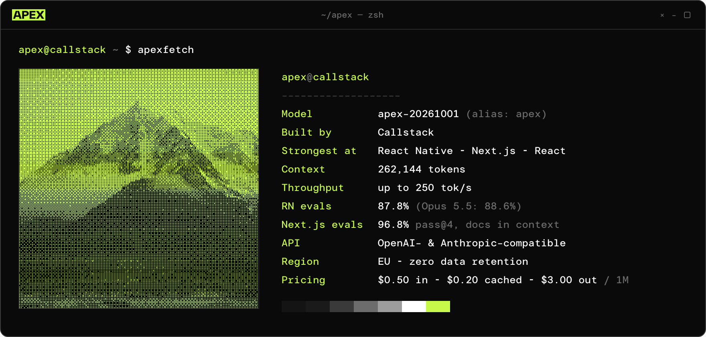

<p>
  <a href="https://apex.callstack.com">
    
  </a>
</p>

<p>
  <a href="https://platform.callstack.ai/signup"></a>&nbsp;
  <a href="https://apex.callstack.com/models"></a>&nbsp;
  <a href="https://discord.gg/gkQrpUkryH"></a>&nbsp;
  <a href="https://status.callstack.ai"></a>&nbsp;
  <a href="https://apex.callstack.com/contact"></a>
</p>

`APEX(1)` <sub>General Commands Manual</sub>

### NAME

**apex** — agentic coding model for mobile and web, fluent in React

### SYNOPSIS

```text
npx @callstack/apex init
apex run <claude | codex | opencode | pi>
apex undo
```

### DESCRIPTION

A cost-effective, general-purpose model for everyday agent work, built by [Callstack](https://callstack.com). Frontier-level where React runs: **React Native** on mobile, **Next.js** on the web. Plans features, writes code, debugs build and runtime failures, reviews changes, writes tests, and carries out React Native, Next.js and library upgrades.

Apex speaks OpenAI- and Anthropic-compatible APIs, so it runs inside Claude Code, Cursor, Codex, OpenCode, VS Code and GitHub Copilot. Swap the endpoint, keep the workflow.



### BENCHMARKS

```text
REACT NATIVE        quality   cost of a full eval run
  Claude Opus 5.5    88.6%    ████████████████████████  $28.75
▶ Apex               87.8%    ██████▍                   $7.72   3.7× cheaper
  GPT 6.1 Sol        86.3%    █████████▌                $11.50

NEXT.JS  pass@4     w/ docs   cost per task
▶ Apex               96.8%    █▊                        $0.067* 13× cheaper
  Claude Opus 5.5    96.8%    ██████▎                   $0.234
  GPT 6 Astra        96.8%    ████████████████████████  $0.891

THROUGHPUT          up to 250 tok/s, up to 3× GPT 6.1 Sol
```

<sub>Sources: [rn-evals.vercel.app](https://rn-evals.vercel.app) · [nextjs.org/evals](https://nextjs.org/evals) (Sep 25, 2026, 31 tasks). *Apex's Next.js cost is estimated from the token usage of its published eval runs. Without docs in context, Apex scores 90.3%, the same as GPT 6 Astra.</sub>

### MODELS

| ID | Type | Context | Released |
|---|---|---|---|
| `apex` | Alias, always the latest snapshot | 262,144 | 2026-10-01 |
| `apex-20261001` | Pinned snapshot, ≥ 6 months' retirement notice | 262,144 | 2026-10-01 |

### ENVIRONMENT

| Name | Value |
|---|---|
| `CALLSTACK_AUTH_TOKEN` | Your API key from [platform.callstack.ai](https://platform.callstack.ai/signup). The CLI only references it, never stores it. |
| OpenAI-compatible | `https://api.callstack.ai/v1` |
| Anthropic-compatible | `https://api.callstack.ai` |

### PRICING

```text
input           $0.50  / 1M tokens
cached input    $0.20  / 1M tokens
output          $3.00  / 1M tokens
on-premise      custom quote
```

<sub>USD, excluding applicable taxes. API access is available to business accounts. Dedicated and on-premise deployments: [contact the team](https://apex.callstack.com/contact).</sub>

### SECURITY

- Processed in the **EU**, with **zero data retention** always on. Prompts and outputs are never stored or used for training.
- SOC 2-compliant infrastructure; security package and DPA available for enterprise.
- Dedicated, your-cloud or on-premise deployments when shared hosting doesn't fit.

### BUGS

Strongest in React Native and React; frontier models still do better on broad general-knowledge tasks. Like any model it can be confidently wrong, so review its output before you ship.

### SEE ALSO

[apex.callstack.com](https://apex.callstack.com) · [models](https://apex.callstack.com/models) · [training data summary](https://apex.callstack.com/legal/training-data-summary) · [@callstack/apex on npm](https://www.npmjs.com/package/@callstack/apex) · [status](https://status.callstack.ai) · [discord](https://discord.gg/gkQrpUkryH)

---

<sub>&nbsp; Callstack &nbsp;·&nbsp; 2026-10-01 &nbsp;·&nbsp; `APEX(1)`</sub>
